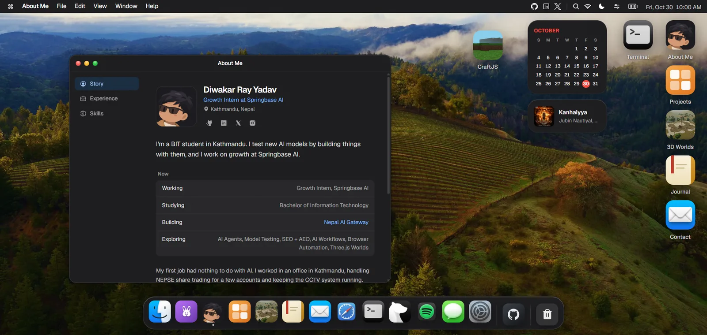
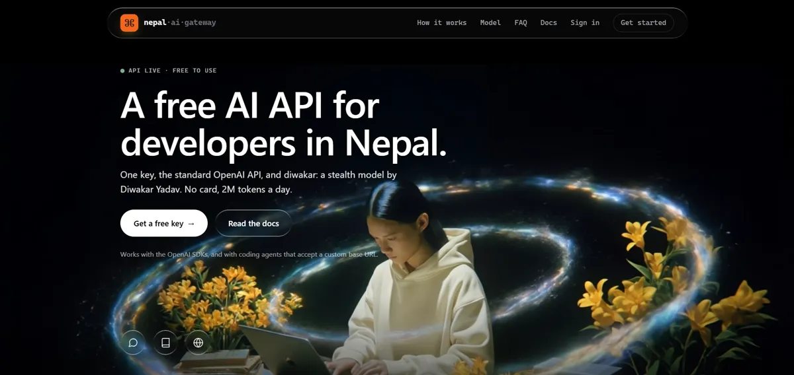
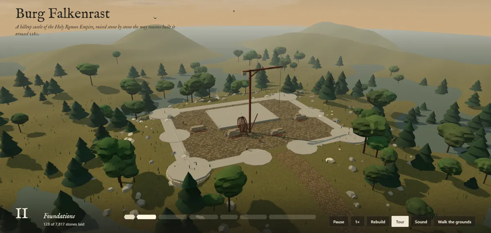
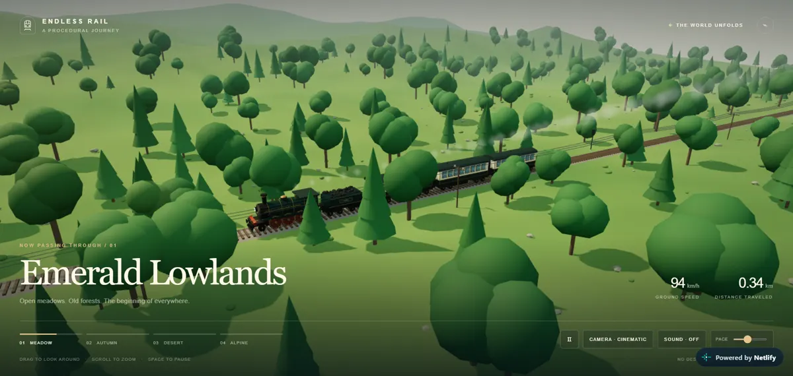
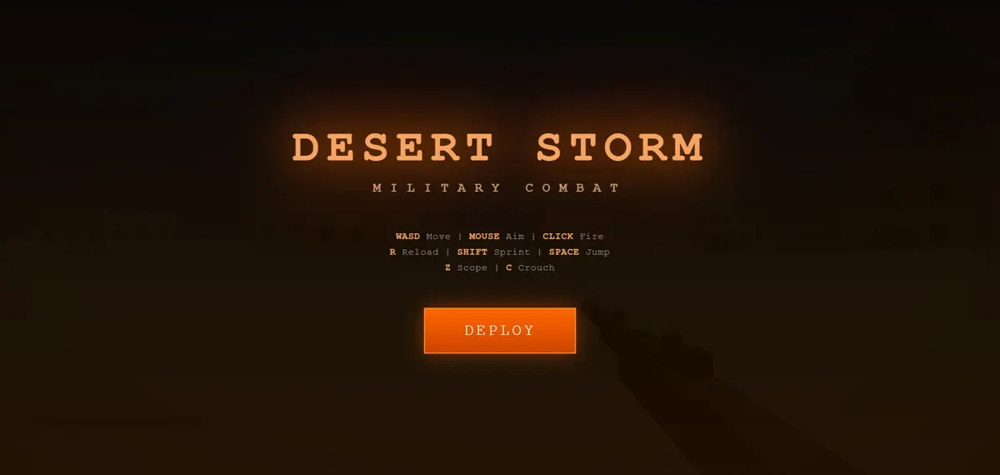

# Diwakar Ray Yadav

BIT student in Kathmandu. I test new AI models by building things with them.

My portfolio as a macOS desktop. Click it to try the live one.

### Hi, I'm Diwakar

My first job had nothing to do with AI. I worked in an office in Kathmandu, handling NEPSE share trading and keeping the CCTV system running. Then AI came along. I started tinkering with it, and I never really stopped.

Today I study BIT, work as a Growth Intern at Springbase AI, and contribute to open source. On the side, I'm learning Python through CS50P. When a new AI model drops, I build something with it and share it on [X](https://x.com/Norwakar).

### Things I've built

<table>
  <tr>
    <td width="50%" valign="top">
      
       <a href="https://ai.diwakaryadav.com.np/"><b>Nepal AI Gateway</b></a>
       A free AI API for developers in Nepal. Most of us don't have international cards, so this one needs none.
    </td>
    <td width="50%" valign="top">
      
       <a href="https://burg-falkenrast.netlify.app/"><b>Burg Falkenrast</b></a>
       A hilltop castle that builds itself stone by stone, 7,817 stones in all. Then you can walk inside.
    </td>
  </tr>
  <tr>
    <td width="50%" valign="top">
      
       <a href="https://olympus-acropolis.netlify.app/"><b>Olympus</b></a>
       An acropolis made only from code. No 3D models and no image textures.
    </td>
    <td width="50%" valign="top">
      
       <a href="https://endless-rail-diwak4r.netlify.app/"><b>Endless Rail</b></a>
       A train ride that never ends, from meadows to desert and alpine peaks.
    </td>
  </tr>
  <tr>
    <td width="50%" valign="top">
      
       <a href="https://magical-moxie-45d3e3.netlify.app/"><b>Desert Storm</b></a>
       A first-person shooter that runs in the browser. No install, no game engine.
    </td>
    <td width="50%" valign="top">
      <b>Smaller tools</b>
        <a href="https://github.com/Diwak4r/SystemCleanerPro">SystemCleaner Pro</a>
       A Windows cleanup script that came out of real IT support work.
        <a href="https://github.com/Diwak4r/File-Organizer">File Organizer</a>
       My second-semester project, and the one that taught me how automation works.
    </td>
  </tr>
</table>

<b>What I work with</b>

 

HTML, CSS & JavaScript · Three.js · React & Next.js · Cloudflare Workers · Supabase · PowerShell · Git & GitHub · Python (learning)

<b>Activity</b>

 

  
  

 

  
  

